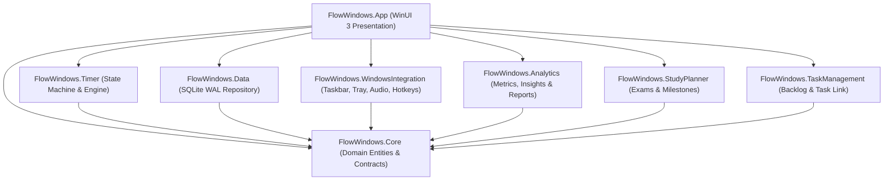
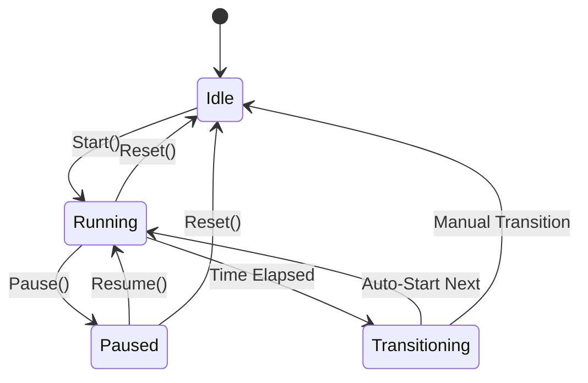

# Architecture Specification: Flow for Windows

## 1. Architectural Philosophy

**Flow for Windows** is engineered as a high-performance, resilient, and native desktop application utilizing modern .NET 8 and WinUI 3 (Windows App SDK). The architecture prioritizes:
1. **Single Authoritative Source of Truth**: A single centralized `TimerEngine` controls all state; no UI window or background service ever maintains an independent timer tick count.
2. **Monotonic Timing Precision**: Relies on `Stopwatch.GetTimestamp()` and UTC delta comparisons rather than decrementing interval integers, guaranteeing drift resistance during OS sleep, window repositioning, or system suspension.
3. **Decoupled Modular Architecture**: Clean separation across Domain Core, Persistence, Timer, OS Integration, Blocker, Analytics, and Presentation.
4. **Local-First & Offline**: Complete zero-cloud footprint, leveraging SQLite in Write-Ahead Logging (WAL) mode.

---

## 2. Solution Topology

---

## 3. Subsystem Breakdown

### 3.1 Domain Core (`FlowWindows.Core`)
- **Entities**: Strongly typed models (`SessionRecord`, `TimerPreset`, `TaskItem`, `StudySubject`, `StudyTopic`, `GoalRecord`, `ActiveSessionState`, etc.).
- **Enums**: `SessionType` (Focus, ShortBreak, LongBreak), `SessionState` (Idle, Running, Paused), `PriorityLevel`, `CommitmentModeLevel`.
- **Contracts**: Interfaces defining repository operations, audio playback, notification dispatch, and timer events (`ITimerEngine`, `IRepository`, `IAnalyticsService`, `ITaskService`, `IStudyPlannerService`, `IGoalsService`).

### 3.2 Authoritative Monotonic Timer Engine (`FlowWindows.Timer`)
- **Engine Mechanics**:
  - Implements `ITimerEngine` with high-resolution wall-clock delta calculation (`DateTimeOffset.UtcNow - _segmentStartTime`).
  - Timer tick calculation does not depend on counting seconds. Instead, elapsed duration is monotonically computed from the authoritative system clock deltas.
  - Periodic heartbeat (every 5 seconds) records active timer state (`ActiveSessionState`) in SQLite WAL database.
  - When the machine enters Connected Standby or sleep, `SystemEvents.PowerModeChanged` and `TimeChanged` trigger immediate resynchronization.
  - Upon unexpected application termination or crash, `MainWindow` detects unclosed sessions ($\ge 10\text{s}$) upon restart and records them into history as completed or interrupted sessions, ensuring zero time loss.
- **Session Transition Pipeline**:
  - Automatic cycle increments: tracks `CurrentCycleSession` vs. `SessionsBeforeLongBreak`.
  - Auto-start transitions: configured through `AutoStartBreaks` and `AutoStartFocus` flags.
- **State Machine**:

### 3.3 Persistence Layer (`FlowWindows.Data`)
- **Engine**: SQLite 3 using `Microsoft.Data.Sqlite`.
- **Configuration**:
  - `PRAGMA journal_mode = WAL;` (Write-Ahead Logging enables non-blocking concurrent reads and fast writes).
  - `PRAGMA synchronous = NORMAL;` (Ensures maximum performance without risking database corruption).
  - `PRAGMA foreign_keys = ON;`
- **Schema Management**: Self-healing table initialization on first startup (`InitializeAsync()`), accompanied by seed presets (Standard 25/5, Deep Work 50/10, Study 45/10, Quick Focus 15/3) and standard tags.
- **Backup & Restore**: Native binary database backup (`ExportDatabaseBackupAsync`) and live restoration (`RestoreDatabaseBackupAsync`).

### 3.4 Windows Integration (`FlowWindows.WindowsIntegration`)
- **Taskbar Progress (`TaskbarManager`)**:
  - Interops with COM interface `ITaskbarList3` (`CLSID_TaskbarList`, `IID_ITaskbarList3`).
  - Transitions taskbar states between `TBPF_NORMAL` (green fill during focus) and `TBPF_PAUSED` (yellow fill during breaks/pauses).
- **System Tray (`SystemTrayManager`)**:
  - Employs WinForms `NotifyIcon` with a dedicated Win32 message context menu.
  - Supports dynamic icons, context menu session status display, and double-click window restoration.
- **Audio Synthesizer (`AudioNotificationService`)**:
  - Zero external sound files needed. Computes pure sinusoidal wave samples with exponential decrescendo decay curves:
    $$\text{Sample}(t) = A \cdot e^{-\alpha t} \cdot \sin(2\pi f t)$$
  - Encodes directly into an in-memory RIFF/WAVE stream played via `System.Media.SoundPlayer`.
- **Single Instance & IPC (`SingleInstanceManager`)**:
  - Uses a named `Local\FlowWindows_SingleInstance_Mutex_2026`.
  - A named pipe server (`FlowWindows_Instance_Activation_Pipe`) listens on the primary process. Subsequent process launches send an activation signal to the pipe and exit immediately, bringing the primary window to the foreground.
- **Global Hotkeys (`GlobalHotkeyManager`)**:
  - Utilizes Win32 `RegisterHotKey` and `UnregisterHotKey` with custom window message filtering.

### 3.5 Presentation Layer (`FlowWindows.App`)
- **WinUI 3 Framework**: Built using unpackaged Windows App SDK with `<WindowsPackageType>None</WindowsPackageType>`.
- **Window Management**:
  - `MainWindow`: Primary multi-view navigation container styled with Mica backdrop and customized titlebar. Intercepts `WM_CLOSE` to trigger minimize-to-tray if enabled.
  - `MiniTimerWindow`: Detachable secondary floating window with `AppWindow.IsAlwaysOnTop = true`, borderless styling, and drag-to-move capabilities via Win32 hit-testing.
- **Custom Controls**:
  - `CircularTimerControl`: Procedurally rendered circular progress bar using XAML `Path` with trigonometric arc calculation:
    $$x = cx + r \cdot \sin(\theta), \quad y = cy - r \cdot \cos(\theta)$$

---

## 4. Multi-Window Synchronization Protocol

Both `MainWindow` and `MiniTimerWindow` observe the identical singleton `ITimerEngine` instance:
1. `TimerEngine.Tick` dispatches on background thread with wall-clock precision.
2. Handlers invoke `DispatcherQueue.TryEnqueue()` to marshall updates onto the respective UI thread.
3. Circular arcs, numerical remaining time strings, and cycle indicators update simultaneously with zero desynchronization.

---

## 5. Security and Privacy Boundaries

- **No Elevated Privileges**: Flow for Windows runs strictly as a standard user process (`asInvoker`). It never installs kernel drivers or tampers with system binaries.
- **Zero Network Activity**: Complete offline application with zero network servers, zero telemetry, and zero outbound network calls.
- **Data Protection**: Database records reside strictly within `%LocalAppData%\FlowWindows\Database\flow.db`.

